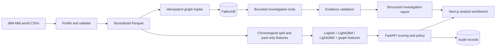

# TraceAML Architecture

## System boundaries

TraceAML is a local-first investigation workbench for replaying synthetic AML transactions. The first iteration includes data preparation and model evaluation, a FalkorDB-backed investigation service, deterministic decision policy, evidence validation, and an analyst UI.

It does not connect to banks, freeze funds, file regulatory reports, or claim production effectiveness. Distributed queues, Redis, vector search, Kubernetes, graph neural networks, and model fine-tuning are deferred.

## Repository map

```text
apps/web/                 Next.js analyst workbench
services/api/             FastAPI, policy, investigation orchestration
ml/                       Data inspection, preparation, features, models, metrics
bench/                    Latency, capacity, and cost benchmark suite (make bench)
graph/                    FalkorDB schema, indexes, and Cypher query definitions
data/raw/                 User-provided source data; ignored by Git
data/processed/           Normalized Parquet and split artifacts; ignored by Git
artifacts/                Generated models and benchmark runs; ignored by Git
docs/                     Product, architecture, contracts, decisions, role charters
compose.yaml              Local FalkorDB service
```

## Component flow



## Data and evaluation

Parquet is the analytical source of truth. The current workspace uses HI-Small Kaggle version 8. `traceaml-inspect-hi-small` writes an aggregate-only source profile; `traceaml-prepare-hi-small` validates and normalizes the transaction file and writes `data/processed/hi-small-v8/transactions.parquet` plus `split-manifest.json`. The manifest records the source hash, schema, composite account-key rule, exact split algorithm, boundaries, and label counts. Use Polars for generic CSV inspection, DuckDB for local analytical queries, and PyArrow/Parquet for durable intermediate tables.

Use a chronological train/validation/test split when timestamps permit it. HI-Small timestamps have one-minute resolution; choose nearest cumulative-count cutoffs to 70%/85% while keeping each full timestamp group together. Feature construction for transaction `t` may use only records strictly earlier than `t`; records at the same minute are simultaneous. Keep labels and typology ground truth in the offline evaluation path. They must not be written to the inference graph or returned by inference queries.

The first benchmark ladder is logistic regression, LightGBM with tabular and historical behavior features, and LightGBM with the same features plus graph-derived features. Train and tune without reading the frozen test labels, and report all models on the same held-out cohort.

## FalkorDB graph

FalkorDB is the authoritative source for transaction topology and structural investigation evidence. The initial graph contains `Account` and `Transaction` nodes connected by `SENT` and `RECEIVED` relationships. Transaction nodes carry a stable source transaction ID, timestamp, amounts, currencies, and payment type as supported by the input schema. Account keys include institution or bank when account IDs are reused.

The graph layer owns schema, indexes, ingestion, and parameterized Cypher. It exposes bounded operations for fund tracing, counterparty inspection, and selected flow patterns. Every traced transfer includes the sender and receiver account keys stored on its transaction node, as well as transaction references, timestamps, graph paths, and query duration. The pass-through query bounds both transfers to the requested time window. A missing graph result remains missing; neither the API, UI, nor LLM fills it in. The loader projects only inference-safe columns and preserves row-derived transaction IDs and duplicate source rows. Its default `merge` mode is idempotent and batched. The `create` mode is for fresh graphs only: it creates each account once, then creates transactions and edges without existence checks. Each account stores `last_epoch`, its latest sent-or-received epoch, which anchors account windows.

Query shape (ADR-017): every account- or transaction-anchored statement binds the indexed key first and then expands that node's adjacency. Only `Account.account_key` and `Transaction.transaction_id` are indexed; Transaction timestamp indexes are not created, because they led the planner into window-wide scans. Fan-out and fan-in run as one statement. Pass-through uses an epoch histogram plus a bounded detail fetch instead of a cross product. Per-call cost therefore grows with the anchor's degree, not with graph size or window volume. `traceaml-graph-bench` (`make graph-bench`) runs the warmup + N-sample latency protocol against a named graph, and `traceaml-synthetic-fixture` writes seeded, label-free latency fixtures. Measured results: `docs/benchmarks/iteration-2-graph-performance.md`.

Offline graph features are computed by default from the Parquet projection with a vectorized builder (`traceaml-build-graph-features-batch`, ADR-015). DuckDB reads and orders only transaction ID, timestamp, and sender/receiver account keys; NumPy deduplicates transfers to pair-minute events and answers every point-in-time distinct-counterparty count with sorted interval keys and binary search, and reverse flow with a first-transfer lookup. It applies the same minute-group visibility rule, window bounds, and smoke-mode trailing-minute drop as the FalkorDB builder, and a parity test asserts row-for-row identical output. On a 5,078,345-row synthetic heavy-tailed input it ran in about 12-14 seconds with about 1.4 GiB peak process memory; on a 200,000-row synthetic prefix it took 1.1 seconds against 130 seconds for the FalkorDB builder, with identical output. These are synthetic measurements on the local development machine.

The FalkorDB builder remains available as a cross-check (`make graph-features-falkordb`). It uses a separate compact `FAccount`/`FLOW` feature graph, so historical feature construction does not alter the transaction-evidence graph. DuckDB externally sorts a projection containing only transaction ID, timestamp, and sender/receiver account keys. The builder processes complete same-minute groups by querying prior state before applying that minute. It creates an account-key index and writes a target-free Parquet sidecar with recent 24-hour in/out counterparty counts for both endpoints and a prior reverse-flow flag. Labels, split assignments, and pattern metadata are not read. The full 5,078,345-row extraction completed in 1,563 seconds, and all rows reconciled. On the frozen test cohort, LightGBM with these graph features scored below the tabular baseline: average precision was 0.1521 versus 0.1587, and recall at a 0.1% alert budget was 14.73% versus 15.89%.

Iteration 1 loaded a 500,000-row prefix (about 706 MiB, 31.3 seconds) and projected about 7 GiB for the full graph. Iteration 2 loaded the full 5,078,345-transaction HI-Small v8 graph (515,088 accounts) in create mode in 521 seconds; all transaction and edge counts reconciled. `GRAPH.MEMORY USAGE` reported 2,514 MB, and the server's `used_memory` peaked at 4.13 GiB during the load. On that graph, the iteration-1 case's five investigation tools summed to 23.2 ms P50, while the five calls anchored on high-degree accounts (degree up to 169,756) summed to 207 ms P95. These are serial measurements on the local development machine (`docs/benchmarks/iteration-2-graph-performance.md`). The compact feature graph is independently built and measured; its capacity does not establish full transaction-graph capacity.

## API, policy, and investigation

FastAPI uses strict Pydantic request and response models. Implemented routes serve a ranked alert queue and benchmark artifacts, then combine target-free replay scores with deterministic `allow`/`review` policy and FalkorDB evidence. The API rejects unknown label-like fields and the score repository fails closed if the replay artifact contains target, split, or typology columns. The default report is a deterministic evidence summary. An optional Gemini tool-calling agent (`api.llm`, ADR-020) runs only when a request sets `use_llm`: it selects among the approved bounded graph tools, drafts a structured report, and deterministic verification checks every cited ID, amount, timestamp, and path against retrieved evidence. Any provider failure or unverifiable claim returns the deterministic report.

The single entrypoint is `api.app:app`. Investigation tool calls run concurrently on pooled FalkorDB connections; the pattern queries overlap the fund-tracing traversal, and the response reports evidence-phase wall time plus per-tool durations (ADR-016). Domain errors map through centralized handlers to fixed-detail 404/409/503/504 responses. Analyst cases and their append-only review history persist in a local SQLite file (`TRACEAML_CASE_DB_PATH`).

The investigation model is optional and is invoked only for selected cases. It receives a score plus records returned by approved graph tools. It may propose hypotheses and summarize evidence, but deterministic validation checks transaction IDs, paths, amounts, and timestamps against retrieved records before showing claims as established. Provider errors or invalid output fall back to deterministic review.

Only explicit analyst confirmation promotes entities into confirmed case memory. Dismissal preserves the transaction history and audit trail. Test/evaluation records never become confirmed memory automatically.

## Analyst workbench

Next.js App Router, TypeScript, Tailwind CSS, and shadcn/ui provide the web application. TanStack Query manages API state, Recharts presents recorded benchmark results, and Cytoscape.js renders graph evidence. The main areas are:

- **Overview (`/`):** review-decision and active-case counts, service health, recent activity, a preview of the latest run's graph, cases needing review, and recent failed runs.
- **Simulation (`/simulation`):** the pipeline rail (alert, context, tool selection, graph query, evidence, verification, policy gate, outcome), each stage read from a field of the investigation response, with the Cytoscape graph workspace (Explore, Path and All modes), the linked evidence table, and an entity drawer. `/investigations` redirects here.
- **Cases (`/cases`):** list, selected-case summary, history, graph evidence, and Confirm or Dismiss review.
- **Alerts (`/alerts`):** the 200 highest-scored alerts with client-side search, decision filter and sort, and an alert drawer with an on-demand graph preview.
- **Benchmarks (`/benchmarks`):** model metrics at the validation threshold and at the fixed review budget, comparison charts, runtime performance, and cost. Iteration 2 candidates (C1, C2) are not served by the API yet and the page says so.
- **System (`/system`):** service health from `/api/health` and artifact probes, the recorded latency snapshot, and run history.

The shell is a persistent sidebar and header (design name: Obsidian Graph Console). Dark is the default theme and light is available; colour is defined once as semantic tokens in `apps/web/app/globals.css`. Statuses are always an icon plus a word.

The UI communicates that its data is a synthetic replay. It never creates graph facts locally; graph structure is rendered from the API's query-backed response. The API does not store runs, failures or events, so Overview and System read a run history kept in this browser (`app/lib/session-runs.ts`) and always label it as such. Recorded mode replays real captured responses (`docs/recorded-runs.md`).

The web client calls the same-origin `/api` path. Next.js rewrites those requests to `TRACEAML_API_ORIGIN` (default `http://127.0.0.1:8000`), avoiding browser CORS configuration for local development. The API and graph loader both use `TRACEAML_GRAPH_NAME`, so the loader must target the same graph configured for the API.

## Local services and reliability

Docker Compose runs FalkorDB locally. The web app and API can run in their native development environments with pnpm and uv. Keep provider credentials in ignored environment files.

If FalkorDB is unavailable, graph-dependent investigation reports an explicit service error rather than presenting a partial graph as complete. If the optional LLM is unavailable or returns invalid data, continue with verified graph evidence and deterministic policy. Bound depth, time windows, result counts, and query execution time to protect the service and browser.
